<p align="center">
  
</p>

<h1 align="center">MediDoor</h1>

<p align="center">
  <b>An AI-assisted, location-aware medicine delivery platform built for Bangladesh.</b><br>
  One FastAPI backend · a responsive website · three Android apps (Customer · Pharmacy · Rider) · a web admin console
</p>

<p align="center">
  
  
  
  
  
  
  
  
  
</p>

<p align="center">
  <a href="#-what-is-medidoor">Overview</a> ·
  <a href="#-screenshots">Screenshots</a> ·
  <a href="#-features">Features</a> ·
  <a href="#-engineering-highlights">Engineering</a> ·
  <a href="#-architecture">Architecture</a> ·
  <a href="#-tech-stack">Tech stack</a> ·
  <a href="#-run-it-locally">Run locally</a>
</p>

---

## 💊 What is MediDoor?

**মেডিসিন হোম ডেলিভারি — আপনার দরজায়।**

MediDoor connects customers with **verified pharmacies within 5 km** and with **riders** who deliver the order.
Instead of a shopping cart, every order happens inside a **chat**: the customer asks, the pharmacy confirms and
packs, a nearby rider joins the same conversation and delivers. A customer can also upload a **handwritten
prescription** — the AI reads it, finds the best nearby pharmacy that has the medicines in stock and prepares
the order for one-tap confirmation.

The whole platform is bilingual (**বাংলা + English**), supports **light and dark themes**, and ships as a website
plus three Play-Store-ready Android apps.

<table>
  <tr>
    <td align="center"><b>149</b><br><sub>REST API endpoints</sub></td>
    <td align="center"><b>4</b><br><sub>Next.js front-ends</sub></td>
    <td align="center"><b>3</b><br><sub>Android apps (TWA)</sub></td>
    <td align="center"><b>~75k</b><br><sub>lines of Python + TypeScript</sub></td>
    <td align="center"><b>25</b><br><sub>unit &amp; end-to-end test scripts</sub></td>
  </tr>
</table>

---

## 📸 Screenshots

### Website

<table>
  <tr>
    <td width="50%">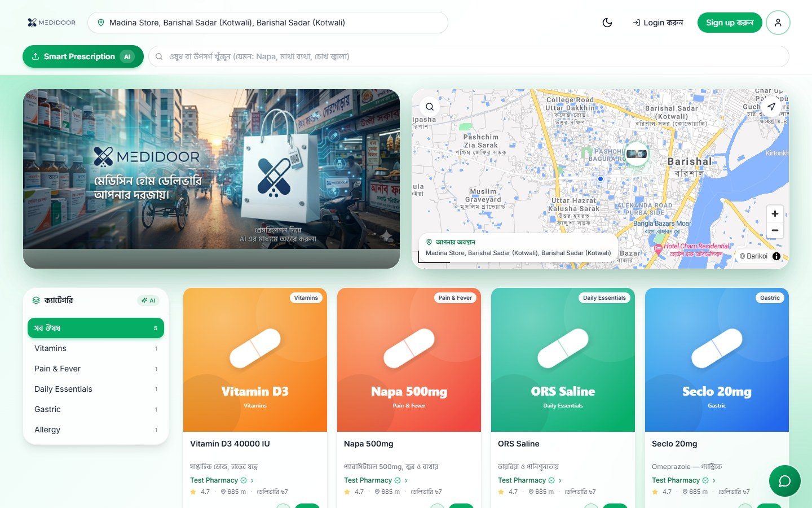</td>
    <td width="50%">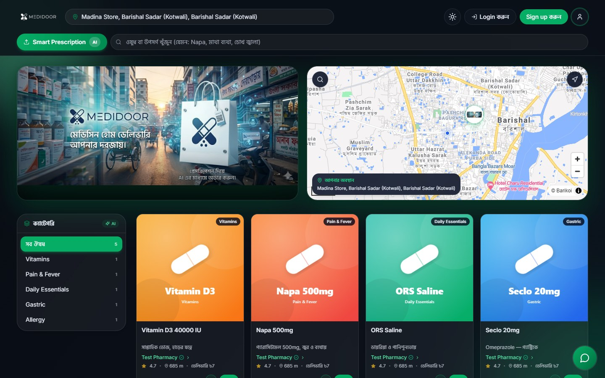</td>
  </tr>
  <tr>
    <td align="center"><sub><b>Storefront</b> — nearby medicines, categories, live map (light)</sub></td>
    <td align="center"><sub>Same storefront in <b>dark mode</b></sub></td>
  </tr>
  <tr>
    <td width="50%">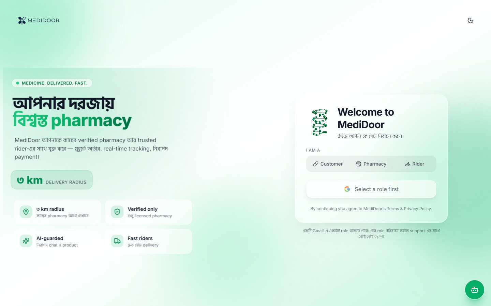</td>
    <td width="50%">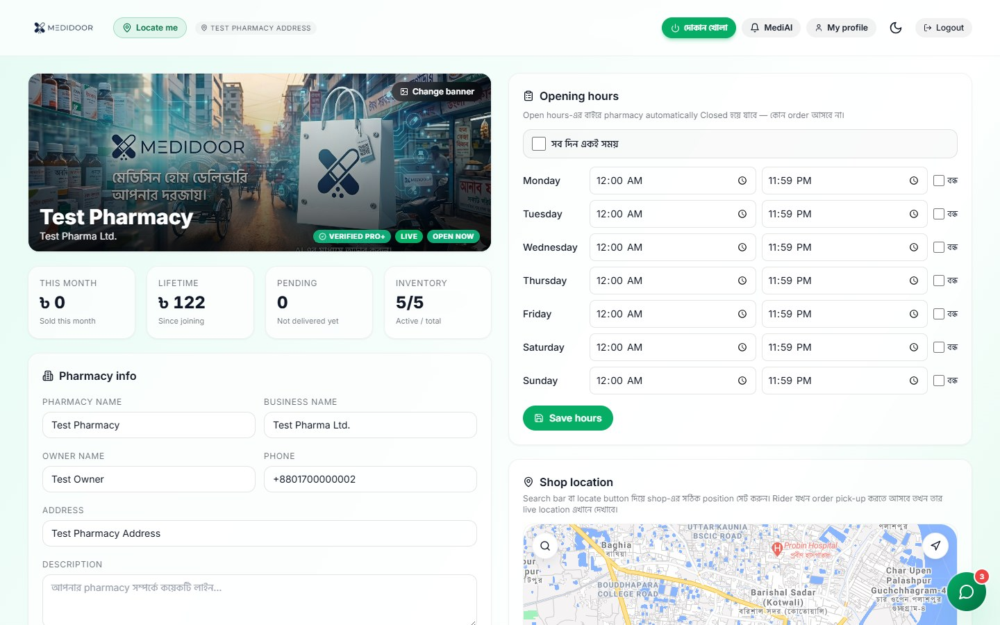</td>
  </tr>
  <tr>
    <td align="center"><sub><b>Sign-in</b> — pick a role, then Google login</sub></td>
    <td align="center"><sub><b>Pharmacy dashboard</b> — sales, inventory, opening hours, shop location</sub></td>
  </tr>
</table>

### Customer app

<p>
  
  &nbsp;Find medicines nearby, scan a prescription with AI, and order through chat.
</p>
<br clear="left">

<table>
  <tr>
    <td align="center">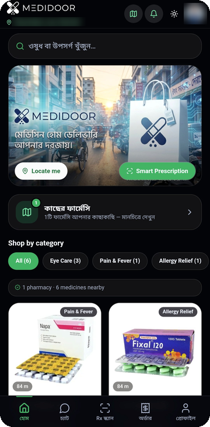<br><sub>Home &amp; nearby pharmacies</sub></td>
    <td align="center">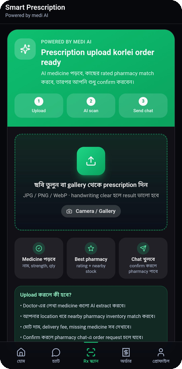<br><sub>Smart Prescription (AI)</sub></td>
    <td align="center">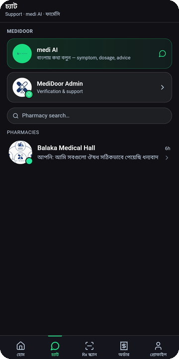<br><sub>medi AI, support &amp; pharmacy chats</sub></td>
  </tr>
</table>

### Pharmacy app

<p>
  
  &nbsp;Run the shop: verification, orders, stock and subscription — all from the phone.
</p>
<br clear="left">

<table>
  <tr>
    <td align="center">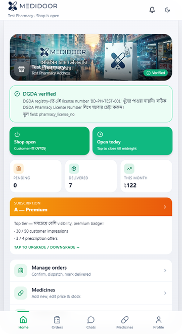<br><sub>DGDA-verified dashboard</sub></td>
    <td align="center">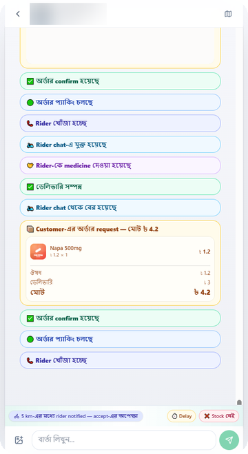<br><sub>Order lifecycle inside the chat</sub></td>
    <td align="center">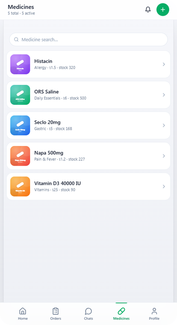<br><sub>Inventory &amp; pricing</sub></td>
  </tr>
</table>

### Rider app

<p>
  
  &nbsp;Go online, receive delivery offers within 5 km, and track earnings.
</p>
<br clear="left">

<table>
  <tr>
    <td align="center">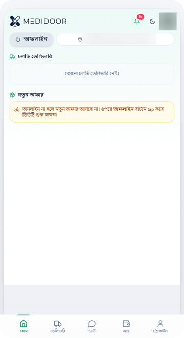<br><sub>Duty toggle &amp; live offers</sub></td>
    <td align="center">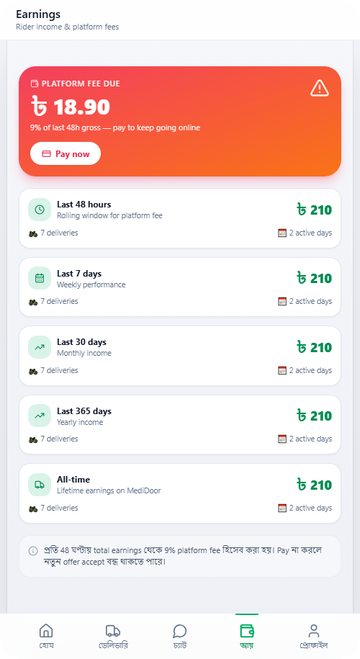<br><sub>Earnings windows &amp; platform fee</sub></td>
  </tr>
</table>

<sub>Personal details in the app screenshots are blurred. Website screenshots were taken from a local run with test data.</sub>

---

## ✨ Features

<table>
  <tr>
    <th width="25%">🧑 Customer</th>
    <th width="25%">🏪 Pharmacy</th>
    <th width="25%">🛵 Rider</th>
    <th width="25%">🛡️ Admin</th>
  </tr>
  <tr valign="top">
    <td>
      • Storefront of medicines from pharmacies within 5 km<br>
      • Search by medicine name <i>or</i> by symptom<br>
      • <b>Smart Prescription</b>: upload a photo, AI extracts the medicines and matches nearby stock<br>
      • <b>medi AI</b> health assistant that talks in Bangla<br>
      • Chat-first ordering, order tracking and cancellation<br>
      • Map of nearby pharmacies
    </td>
    <td>
      • License check against the <b>DGDA</b> registry, with periodic re-verification<br>
      • Dashboard: sales, pending orders, inventory health<br>
      • Add products with <b>AI autofill</b> from a product photo<br>
      • Opening hours, shop location, banner<br>
      • Order chat with confirm → packing → rider steps<br>
      • Subscription tiers (Basic / Pro / Premium)
    </td>
    <td>
      • One-tap online / offline duty<br>
      • Delivery offers broadcast to riders within 5 km of the pharmacy<br>
      • Joins the customer–pharmacy chat for the delivery<br>
      • Earnings for 48 h / 7 / 30 / 365 days and all-time<br>
      • Transparent 9% platform fee
    </td>
    <td>
      • Web admin console (served by the backend)<br>
      • Content CMS for banners, pages and login screen<br>
      • Users, bans and blocks, rider verification<br>
      • Order controls, product &amp; chat moderation<br>
      • Full admin audit log
    </td>
  </tr>
</table>

---

## 🧠 Engineering highlights

- **Chat-first order lifecycle** — an order is a set of structured event cards inside a three-party conversation
  (customer ↔ pharmacy ↔ rider): request, quote, confirm, packing, rider search, hand-over, delivered.
- **Smart Prescription pipeline** — Gemini vision reads the prescription, a fuzzy name matcher scores it against
  each nearby pharmacy's inventory, and the customer gets per-pharmacy proposals with total price, delivery fee
  and missing items.
- **AI safety built in** — every chat message gets a real-time risk scan (for example attempts to move a deal
  off-platform), and medi AI follows strict boundary rules about when it may speak in a chat.
- **Tier exposure engine** — the subscription tier (Basic / Pro / Premium) sets each pharmacy's share of
  customer impressions and prescription offers (3 : 2 : 1), while a Bayesian rating and distance only nudge the
  order *within* a tier (±15%, clamped). It is pure and deterministic, so it is fully unit-tested — and it never
  hides the option that can actually fulfil a prescription.
- **One geo policy module** — the 5 km connect radius, rider location freshness (15 min) and graceful fallback
  from Barikoi to OSM Nominatim live in one place so no route can drift out of sync.
- **Security by design** — Google OAuth only (no passwords to leak), stateless JWT access/refresh tokens,
  short-lived signed URLs for private files (prescriptions, NID, licenses), brute-force throttling on the admin
  console, a 90-day data-retention sweep, per-user AI quotas and Gemini API-key pool rotation.
- **Android without a second codebase** — each app is a Trusted Web Activity shell verified with Digital Asset
  Links, so the Play Store apps run full-screen and update the moment the web app is deployed.

---

## 🏗️ Architecture

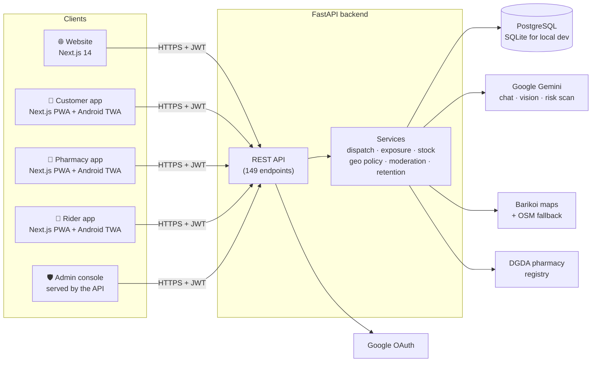

### How an order flows

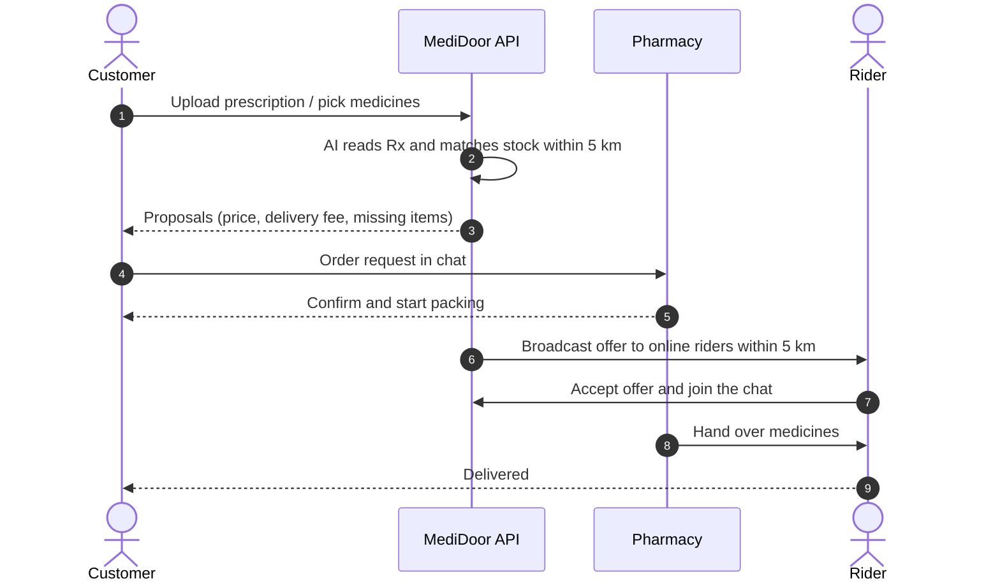

---

## 🧰 Tech stack

| Layer | Technology |
| --- | --- |
| **Front-end** | Next.js 14 (App Router), React 18, TypeScript, Tailwind CSS, Framer Motion, next-themes |
| **Maps & 3D** | MapLibre GL, Barikoi geocoding with OpenStreetMap Nominatim fallback, Three.js / React Three Fiber |
| **Backend** | FastAPI, async SQLAlchemy 2, Pydantic v2, Uvicorn |
| **Data** | PostgreSQL 16 (production), SQLite (zero-setup local dev), Redis (optional) |
| **Auth** | Google OAuth 2.0 (Authlib), JWT access + refresh tokens, signed file URLs |
| **AI** | Google Gemini — chat assistant, prescription vision, product autofill, message risk scan |
| **Mobile** | Installable PWAs wrapped as Android Trusted Web Activities (androidbrowserhelper) |
| **Testing** | Python unit tests and end-to-end API flow scripts (chat, handshake, moderation, geo, exposure) |

---

## 📁 Project structure

```text
MediDoor/
├── backend/                FastAPI app
│   ├── app/
│   │   ├── api/routes/     17 route modules (auth, storefront, orders, ai, rider, admin…)
│   │   ├── models/         SQLAlchemy models
│   │   ├── services/       dispatch, exposure engine, geo policy, DGDA verify, retention…
│   │   ├── core/           settings and security (JWT)
│   │   ├── db/             session, schema auto-patch, seed scripts
│   │   └── static/         web admin console (single-page app)
│   └── content/            CMS content (site, login, documents, medi AI)
├── frontend/               Website — customer storefront + pharmacy & rider web panels
├── mobile-customer/        Customer PWA  + android/ (TWA shell)
├── mobile-pharmacy/        Pharmacy PWA  + android/ (TWA shell)
├── mobile-rider/           Rider PWA     + android/ (TWA shell)
├── tools/tests/            unit and end-to-end test scripts
├── docs/                   architecture notes and screenshots
├── run.py                  one-command local launcher
└── docker-compose.yml      optional PostgreSQL + Redis for local dev
```

---

## 🚀 Run it locally

**Requirements:** Python 3.11+, Node.js 20+, npm.

```bash
git clone https://github.com/shizan52/MediDoor.git
cd MediDoor
python run.py
```

`run.py` is idempotent. It creates the Python virtual environment, copies the example `.env` files, generates a
`SECRET_KEY`, installs npm packages and starts every service with live logs:

| Service | URL |
| --- | --- |
| FastAPI backend (Swagger at `/docs`) | http://localhost:8000 |
| Admin console | http://localhost:8000/admin |
| Website | http://localhost:3000 |
| Customer app | http://localhost:3100 |
| Pharmacy app | http://localhost:3200 |
| Rider app | http://localhost:3300 |

**Configuration** — edit `backend/.env` (created from [`backend/.env.example`](backend/.env.example)):

- `GOOGLE_CLIENT_ID` / `GOOGLE_CLIENT_SECRET` — Google OAuth credentials for sign-in
- `GEMINI_API_KEYS` — one or more Gemini keys for the AI features (optional)
- `BARIKOI_API_KEY` — Barikoi maps key (optional; OpenStreetMap is used as a fallback)
- `ADMIN_CONSOLE_PASSWORD` — password for the web admin console

SQLite is used by default, so no database server is needed. To use PostgreSQL, run `docker compose up -d` and
switch `DATABASE_URL`. Seed test accounts with `python -m app.db.seed_test_accounts` from the `backend` folder.

More detail on the auth model is in [docs/cookie-token-guide.md](docs/cookie-token-guide.md) (Bangla).

---

## 🔒 About this repository

This is a **portfolio snapshot** of the MediDoor source code. Production deployment scripts, server
configuration, signing keys, API keys and all real user data are intentionally **not** included.

---

## 👤 Author

**Tayb Hassan Shizan** — designed and built MediDoor end to end: product, backend, web, mobile and deployment.

[](https://github.com/shizan52)

Interested in working together on a similar platform? Open an issue or reach out on GitHub.

---

<p align="center"><sub>© 2026 Tayb Hassan Shizan. All rights reserved. The source is shared for portfolio and review purposes.</sub></p>
